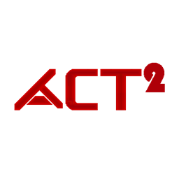

 

 
 
 
 

## ActX.

ActX is a eaglercraft client based on a *Curseforge* Mod (Advanced Creative Tab by ATE47) meaning that's where the name came from. 
- `Act` stands for Advanced Creative Tab
- `X` tells you that it's a eaglercraft client. 
It`s very easy to understand the name of the client. This is a personal project i really felt like to make, nothing else.

## What it contains.

- It contains more opti-fine settings into eaglercraft. (*Quality, Details, Animations, Others*)
- 26.2 Items that have been ported into 1.8.8.
- More singleplayer features/support, and WispCraft support.
- Use illegal characters in chat (paste § and it'll register without it being ignored but ofc it will kick you out if you try to send it.)
- More FNAW Skins (for now there is just one custom FNAW Skins added)
## ActX's source code.

Here's the link leading to the source code of [ActX](https://github.com/Numberoneguy/ACTX-source-code) 
This contains files of ****craft and some of the files i've modified located in `src/game/java/net/****craft/actx`.

